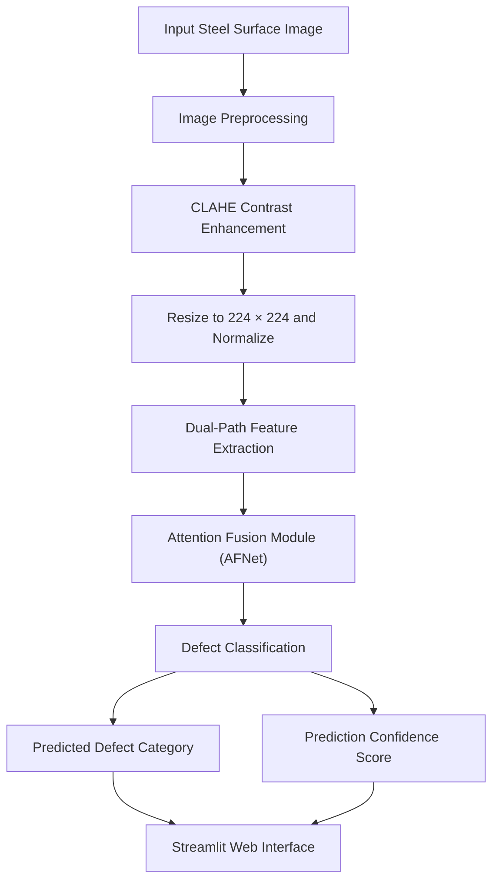

# SteelScan AI: Surface Defect Detection System

A deep learning-based computer vision system for classifying industrial steel surface defects in real time. Built using **PyTorch, OpenCV, and Streamlit**, SteelScan AI leverages a custom **DualPath-AFNet** architecture to identify surface anomalies and provide prediction confidence scores through an interactive web application.

## Overview

SteelScan AI was developed as an **8th-semester B.Tech Computer Science and Engineering major project** to improve automated visual inspection and quality control in metallurgical manufacturing.

The system processes steel surface images, extracts fine-grained and high-level features, and classifies defects into six categories. A Streamlit-based web interface allows users to upload images and obtain predictions directly in their browser.

### Key Features

- **Deep Learning-Based Classification:** Custom DualPath-AFNet architecture for steel surface defect classification.
- **Dual-Path Feature Extraction:** Captures both global semantic context and localized surface details.
- **Attention-Based Feature Fusion:** Dynamically combines complementary features to improve defect representation.
- **Image Preprocessing:** CLAHE-based contrast enhancement and image resizing.
- **Confidence Scoring:** Displays the model's prediction confidence alongside the predicted class.
- **Interactive Web Interface:** Upload and analyze steel surface images using Streamlit.
- **Six Defect Categories:** Supports crazing, inclusion, patches, pitted surfaces, rolled-in scale, and scratches.

## System Architecture

The system consists of four primary stages:

1. **Image Preprocessing:** Applies Contrast Limited Adaptive Histogram Equalization (CLAHE) to improve local contrast, followed by resizing and normalization to prepare images as 224 × 224 tensors.
2. **Dual-Path Feature Extraction:** Processes image information through parallel feature-extraction paths to capture high-level semantic information and localized surface patterns.
3. **Attention Fusion Module (AFNet):** Combines the extracted features by emphasizing relevant spatial anomalies and structural characteristics.
4. **Classification and Confidence Scoring:** Predicts the defect category and provides a confidence score for the resulting classification.

### Architecture Diagram



## Supported Defect Categories

The model classifies steel surface images into the following six categories:

| Defect Class | Description |
|---|---|
| Crazing | Fine networks of cracks on the steel surface |
| Inclusion | Foreign materials or embedded impurities within the material |
| Patches | Irregular surface patches with distinct visual characteristics |
| Pitted Surface | Small cavities or depressions on the steel surface |
| Rolled-in Scale | Oxide scale pressed into the steel during rolling |
| Scratches | Linear surface marks caused by friction or mechanical contact |

## Results and Performance

The model was trained and evaluated using standard industrial steel surface defect datasets.

| Model | Architecture | Reported Performance |
|---|---|---|
| Baseline Backbone | Standard CNN | Approximately 86% accuracy |
| **DualPath-AFNet v2** | Dual-Path Feature Extraction + Attention Fusion | High-precision classification |

**Note:** The final numerical accuracy, precision, recall, and F1-score for DualPath-AFNet v2 should be added after verification against the model's evaluation results.

## Technology Stack

| Category | Technologies |
|---|---|
| Programming Language | Python |
| Deep Learning | PyTorch, torchvision |
| Computer Vision | OpenCV, PIL/Pillow |
| Web Application | Streamlit |
| Data Processing | NumPy, Pandas |
| Model Evaluation | Scikit-learn |
| Visualization | Matplotlib |

## Repository Structure

```text
steelscan-ai/
├── DualPathAFNet_v2_best.pth  # Trained model weights
├── app.py                     # Streamlit web application
├── requirements.txt           # Python dependencies
└── README.md                  # Project documentation
```

The model architecture was developed and trained using PyTorch. The trained weights were saved as `DualPathAFNet_v2_best.pth` and are loaded locally by the Streamlit application for inference.

## Getting Started

### Prerequisites

Ensure that the following are installed:

- Python 3.9 or later
- Git
- pip
- A compatible environment for running PyTorch

### 1. Clone the Repository

```bash
git clone https://github.com/devyanighildiyal/steelscan-ai.git
cd steelscan-ai
```

### 2. Create a Virtual Environment

**Windows:**

```bash
python -m venv venv
venv\Scripts\activate
```

**Linux/macOS:**

```bash
python3 -m venv venv
source venv/bin/activate
```

### 3. Install Dependencies

```bash
python -m pip install --upgrade pip
pip install -r requirements.txt
```

Ensure that the trained model weights file, `DualPathAFNet_v2_best.pth`, is present in the expected location before launching the application.

## Usage

Start the Streamlit application:

```bash
streamlit run app.py
```

Open the local URL displayed in the terminal, usually:

```text
http://localhost:8501
```

### Inference Workflow

1. Launch the Streamlit application.
2. Upload an image of a steel surface.
3. Allow the application to preprocess the image.
4. View the predicted defect category.
5. Review the associated prediction confidence score.

## Applications

SteelScan AI demonstrates the potential of deep learning-based visual inspection in industrial quality control, including:

- Automated steel surface inspection.
- Manufacturing defect classification.
- Metallurgical quality assurance.
- Computer vision-based industrial inspection workflows.
- AI-assisted defect screening and decision support.

The system is intended as a prototype for automated inspection. Predictions should be validated against expert inspection and established quality-control procedures before use in production environments.

## Future Improvements

Potential directions for further development include:

- Adding localization or segmentation to identify the precise defect region.
- Expanding evaluation with per-class precision, recall, F1-score, and confusion matrices.
- Benchmarking inference latency and throughput under realistic operating conditions.
- Integrating live camera feeds for continuous inspection.
- Deploying the application as a cloud-hosted inference service.
- Adding explainability visualizations, such as Grad-CAM, to highlight influential image regions.

## Team and Acknowledgments

| Detail | Information |
|---|---|
| Developer | Devyani Ghildiyal |
| Project Type | B.Tech 8th Semester Major Project |
| Project Guide | Prof. Anil Kumar |
| Recognition | Letter of Recommendation (LOR) |

I extend my sincere gratitude to **Prof. Anil Kumar** for his valuable mentorship, technical guidance, and support throughout the development of this project.
